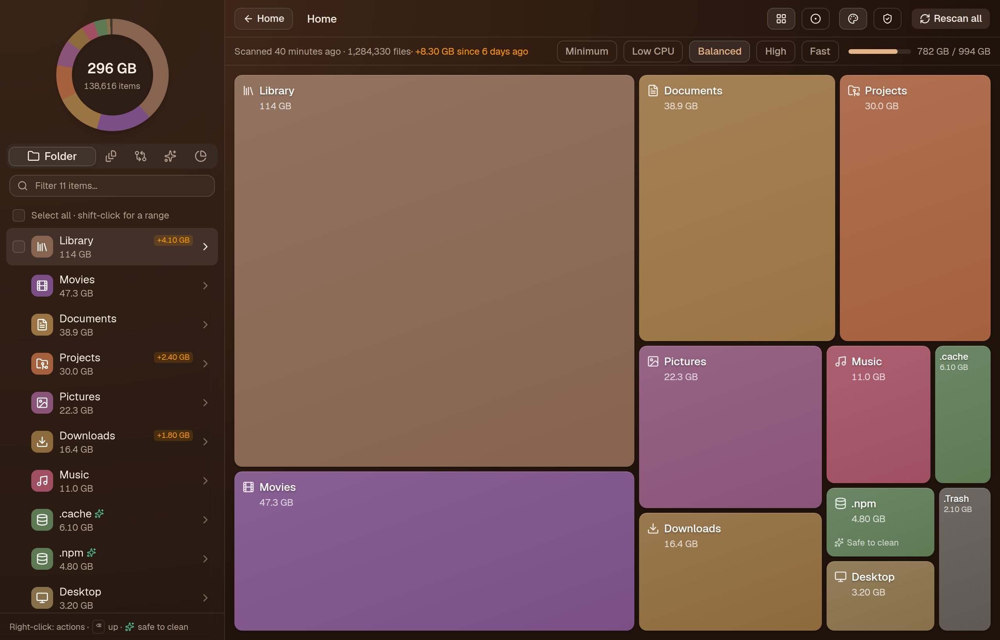
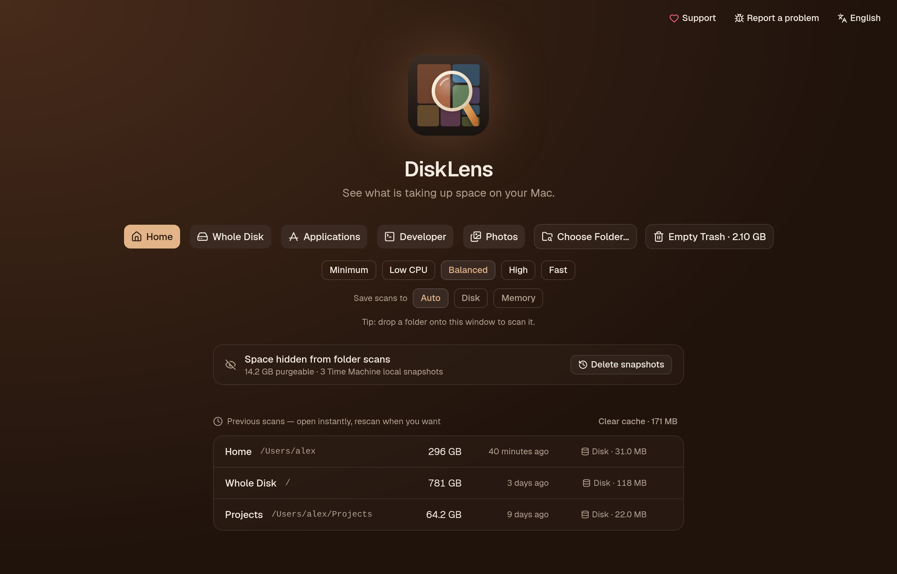
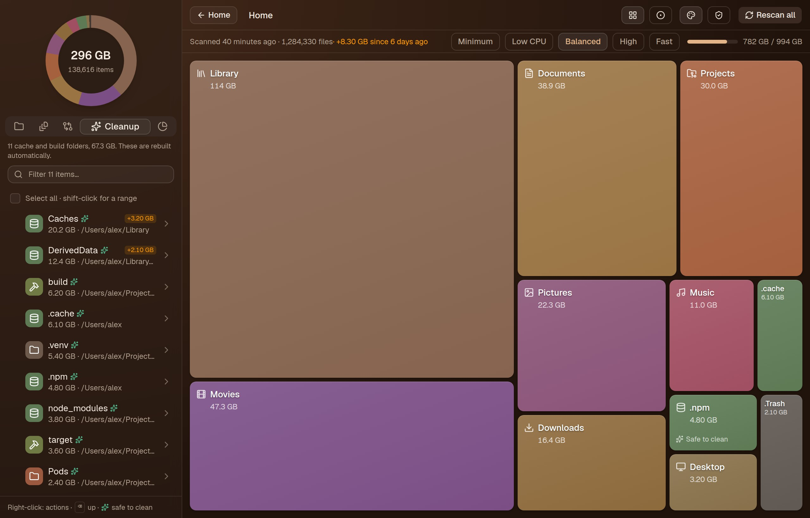
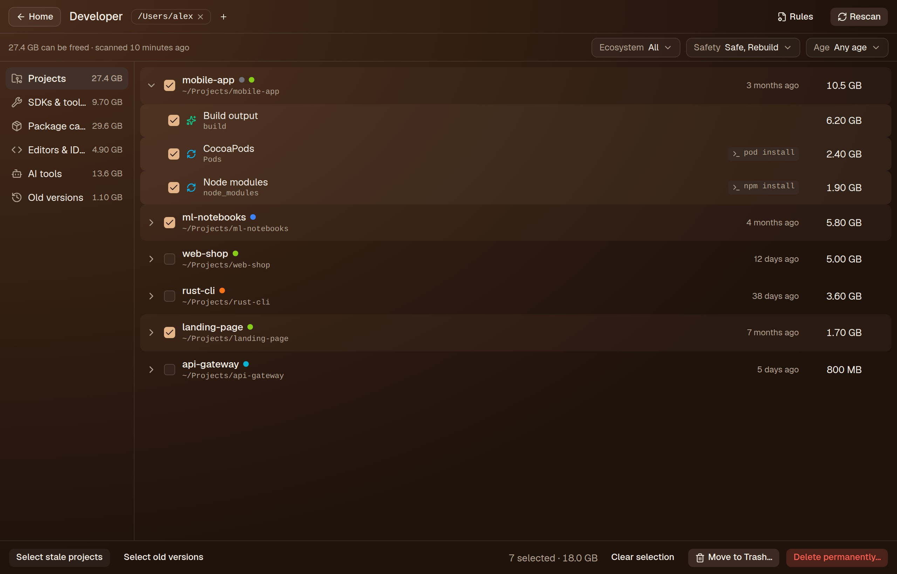
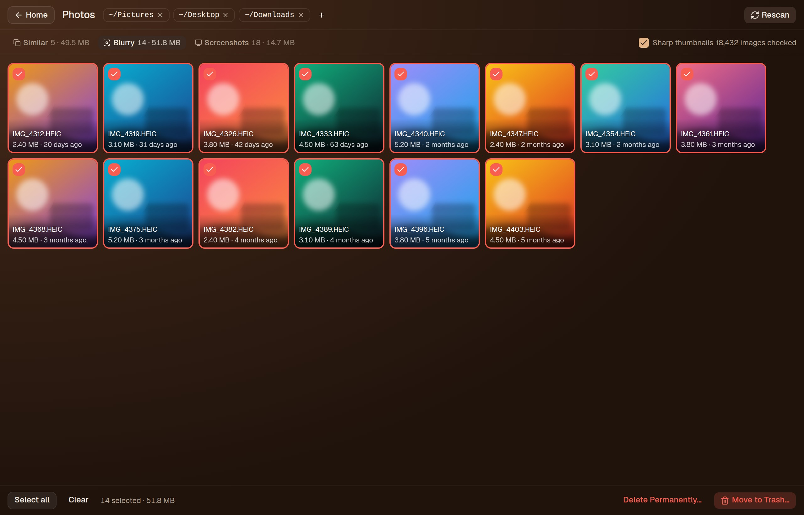
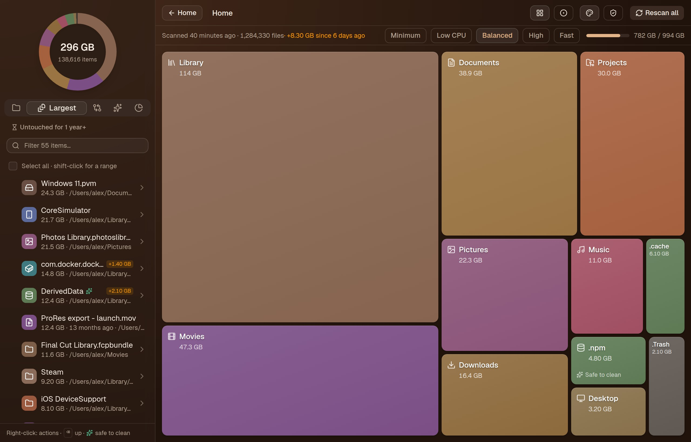
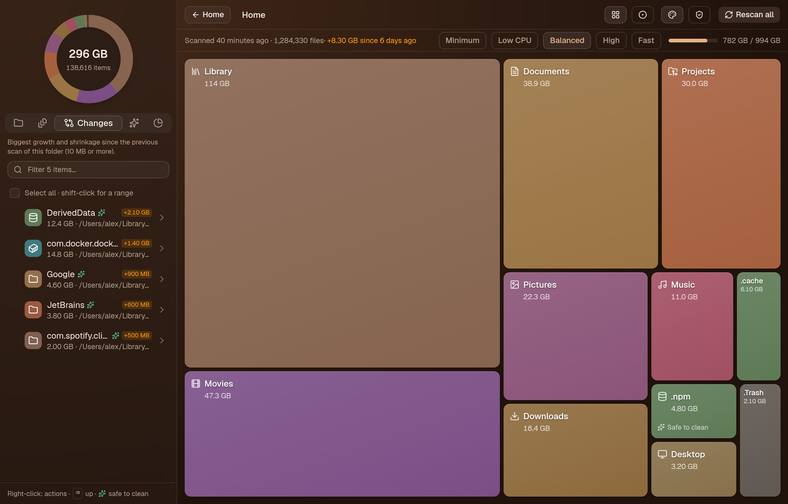
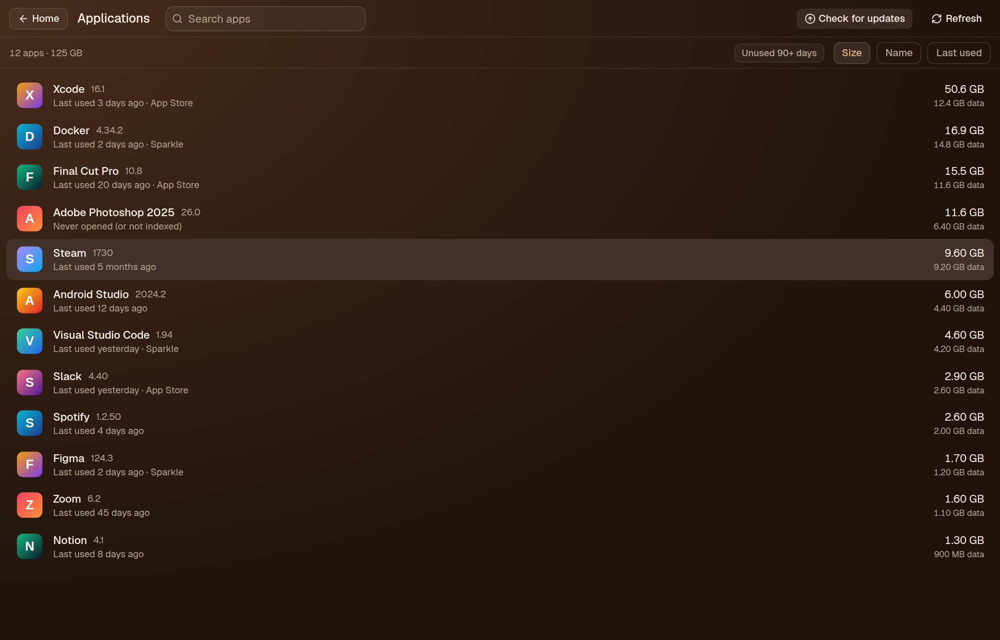
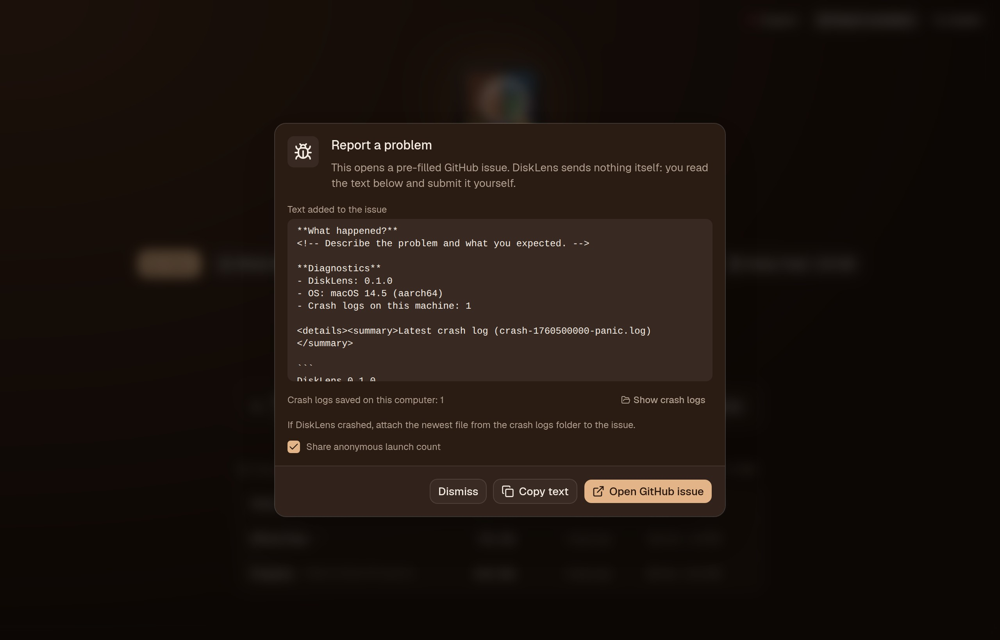

# DiskLens

A fast, open-source disk space analyzer and cleaner for macOS and Linux (Ubuntu), in the spirit of
CleanMyMac and Mole. Built with Tauri 2 (Rust) and React.



[**Slides**](docs/slides.html) (open the file in a browser; ← → to move, F for fullscreen). All numbers in the screenshots are sample data.

- **Treemap of any folder.** Click a tile to drill in. Every tile stays visible, so small folders don't vanish next to a 200 GB one.
- **Colours and icons by kind.** Caches, build output, `node_modules`, Docker, AI models, iOS backups and so on. Folders that are usually safe to clean are marked ✨.
- **Largest Files tab.** Select several files and remove them in one go. Filter to files untouched for a year.
- **Changes since the last scan.** Every folder shows how much it grew or shrank, and a Changes tab lists what grew most.
- **Drag & drop** a folder onto the window to scan it.
- **Photos.** Finds blurry photos, screenshots and near-identical shots, and keeps the best of each group.
- **Menu bar / tray icon** with free space and one-click scans.
- **Rescan one folder** without rescanning the whole disk.
- **Cached results.** Previous scans open instantly. They go to disk, or to memory when the disk is nearly full (or you choose so).
- **Low CPU mode.** The scan runs at background CPU and disk priority, so you can keep working while it scans.
- **Applications.** For each app you get:
  - its icon, version and when you last used it;
  - its real size, bundle plus `~/Library` data;
  - App Store and Sparkle update checks;
  - uninstall, or reset its data.
- **Safe deletes.**
  - **Move to Trash** asks once.
  - **Delete permanently** asks twice.
  - System folders are always refused.
- **Developer cleanup.**
  - Finds `node_modules`, `target`, `.venv`, Pods and build folders inside your projects.
  - Also SDKs, package caches, editor and AI-tool caches, old toolchain versions and git worktrees.
  - Each item is *Safe*, *Rebuild* (shows the command that brings it back) or *Caution*.
  - Your own rules go in `~/.config/disklens/rules.json`.

> Status: early (0.x). macOS and Linux; Windows is planned. Bug reports and pull requests are welcome.

## Screenshots

Sample data, taken from the real UI (`scripts/screenshots`).

| | |
| --- | --- |
|  |  |
| **Start screen**: scans, previous results, hidden space | **Cleanup**: safe-to-clean caches and build folders |
|  |  |
| **Developer**: project artifacts, SDKs, package and AI caches | **Photos**: blurry, screenshots, similar shots |
|  |  |
| **Largest**: biggest files, optionally untouched for a year | **Changes**: what grew since the previous scan |
|  |  |
| **Applications** (macOS): app and data size, updates | **Report a problem**: you review the text, then submit |

To retake them: `npx vite --port 1420`, then `node scripts/screenshots/capture.mjs`. The script fakes the backend with `scripts/screenshots/mock.js`, so no real disk is scanned.

## macOS vs Linux

Most of DiskLens works the same everywhere. A few features rely on macOS-only system services.

| Feature | macOS | Linux (Ubuntu) | Notes |
| --- | :---: | :---: | --- |
| Treemap / bubbles of any folder, drill-down | ✅ | ✅ | |
| Scan whole disk (`/`) | ✅ | ✅ | Linux: local ext4/btrfs/xfs/… partitions only; skips `/proc`, `/sys`, `/run`, `/snap`, `/media`, `/mnt` |
| Largest files, "untouched for 1 year+" filter | ✅ | ✅ | |
| Changes since the previous scan | ✅ | ✅ | |
| Cleanup suggestions (caches, build output, safety levels) | ✅ | ✅ | Linux paths: `~/.cache`, `~/.config/Code`, `~/.local/share/JetBrains`, `~/Android/Sdk`, … |
| Developer cleanup (projects, SDKs, IDE & AI tool caches, git worktrees) | ✅ | ✅ | |
| Rescan one folder, cached results, scan history | ✅ | ✅ | |
| Move to Trash / Delete permanently (two-step) | ✅ | ✅ | Linux uses the freedesktop Trash (`~/.local/share/Trash`) |
| Empty Trash | ✅ | ✅ | |
| Protected system paths | ✅ | ✅ | Linux also guards `/etc`, `/boot`, `/usr`, `/var/lib`, `/home`, … |
| Low CPU mode | ✅ | ✅ | macOS: background QoS. Linux: `nice` 19 + idle I/O class |
| Drag & drop a folder to scan | ✅ | ✅ | |
| Photos: blurry, screenshots, similar shots | ✅ | ⚠️ | Linux can't decode HEIC/HEIF; those are only matched as screenshots by name |
| Menu bar / tray icon | ✅ | ⚠️ | Linux needs AppIndicator (GNOME: the *AppIndicator* extension; preinstalled on Ubuntu) |
| Show / open in Finder (file manager) | ✅ | ✅ | |
| Quick Look (Space) | ✅ | ❌ | macOS only |
| Applications: sizes, last used, updates, uninstall | ✅ | ❌ | macOS only (`.app` bundles); on Linux use your package manager |
| Hidden space: purgeable + Time Machine local snapshots | ✅ | ❌ | macOS only (APFS / Time Machine) |
| Full Disk Access check | ✅ | — | Not needed on Linux |
| 12 languages | ✅ | ✅ | |

Windows support is planned; the platform layer (`src-tauri/src/platform/`) is ready for a `windows.rs`.

## Privacy, crash logs and bug reports

- DiskLens works offline. Your files, paths and scan results never leave your computer.
- **Launch count (opt-in).** If this build has an [Aptabase](https://aptabase.com) key, the first launch asks whether to share an anonymous count of launches (app version and OS only). You can change your answer in *Report a problem*.
- **Crash logs stay local.** Panics and UI errors are saved as text files in the app data folder (`~/.local/share/com.nhamhv.disklens/crashes` on Linux, `~/Library/Application Support/com.nhamhv.disklens/crashes` on macOS). Home folder and user names are removed.
- **Report a problem** (top right of the start screen) shows what would go into a GitHub issue and opens it prefilled. You read it and submit it yourself; attach a crash log if there is one.
- Building your own copy? Set `APTABASE_APP_KEY` at build time to enable the launch count. Without it nothing is ever sent.

## Install

Download from [Releases](../../releases):

- **macOS:** the `.dmg`.
- **Ubuntu / Debian:** the `.deb` (`sudo apt install ./DiskLens_*.deb`).
- **Other Linux:** the `.AppImage` (`chmod +x DiskLens_*.AppImage` and run it).

### macOS first launch

The builds are not notarized yet, so the first launch needs one extra step. Do **one** of these:

- **Right-click** `DiskLens.app` → **Open** → **Open**, or
- run `xattr -dr com.apple.quarantine "/Applications/DiskLens.app"`.

### Full Disk Access (macOS)

Without Full Disk Access, macOS hides some folders: Mail, Safari, and other apps' containers. To measure everything, open
**System Settings → Privacy & Security → Full Disk Access**, click **+**, and add `DiskLens.app`.
The app shows a shortcut to this screen when access is missing.

## Build from source

Requirements:

- macOS 12+, or Ubuntu 22.04+ (other Linux distributions with WebKitGTK 4.1 should work)
- [Rust](https://rustup.rs) (stable)
- Node.js 20+
- macOS: Xcode Command Line Tools: `xcode-select --install`
- Ubuntu / Debian:

  ```sh
  sudo apt install build-essential pkg-config libwebkit2gtk-4.1-dev \
    libayatana-appindicator3-dev librsvg2-dev libxdo-dev libssl-dev
  ```

```sh
npm install
npm start            # dev mode with hot reload (picks a free port if 1420 is busy)
npm run release      # optimized bundles in src-tauri/target/release/bundle/ (.app + .dmg, or .deb + .AppImage)
```

On macOS, to build a universal binary that runs on both Apple Silicon and Intel:

```sh
rustup target add aarch64-apple-darwin x86_64-apple-darwin
npm run release -- --target universal-apple-darwin
```

## Documentation

- [ARCHITECTURE.md](ARCHITECTURE.md): how scanning, caching, deleting and app detection work.
- [CONTRIBUTING.md](CONTRIBUTING.md): dev setup, code style, adding a language.
- [DISTRIBUTION.md](DISTRIBUTION.md): the plan for releasing builds to Homebrew, Snap, Flatpak, APT and more.
- [CHANGELOG.md](CHANGELOG.md)

## License

[Apache-2.0](LICENSE)
